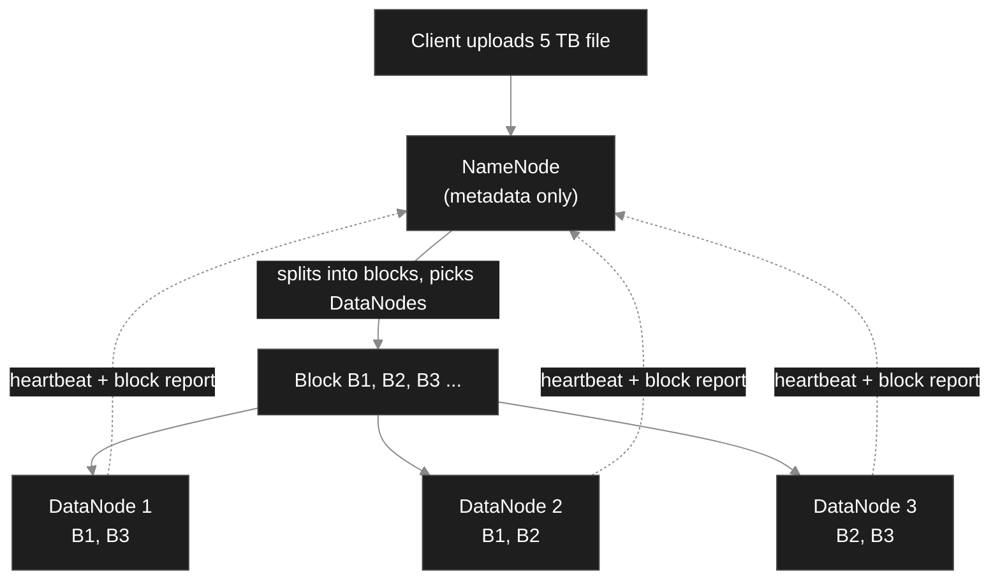
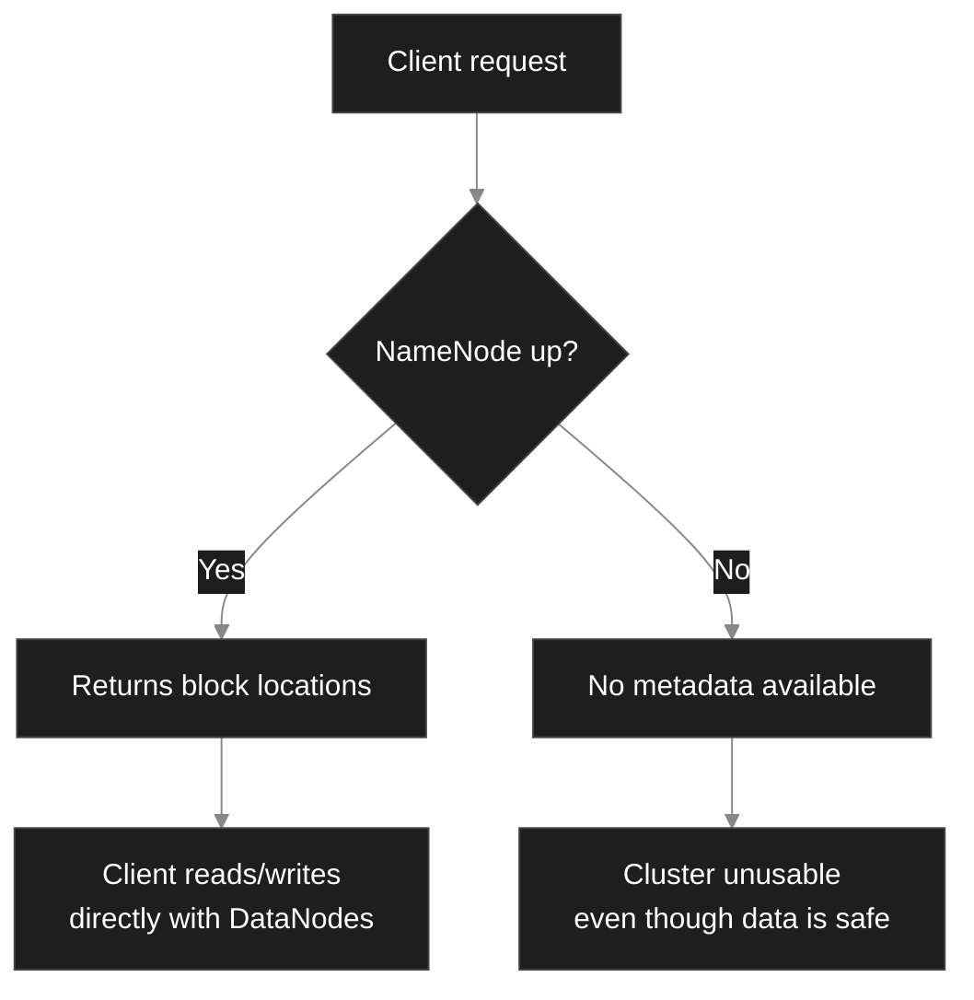
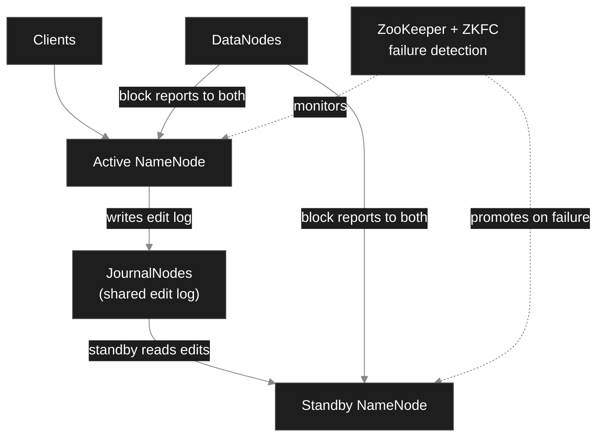
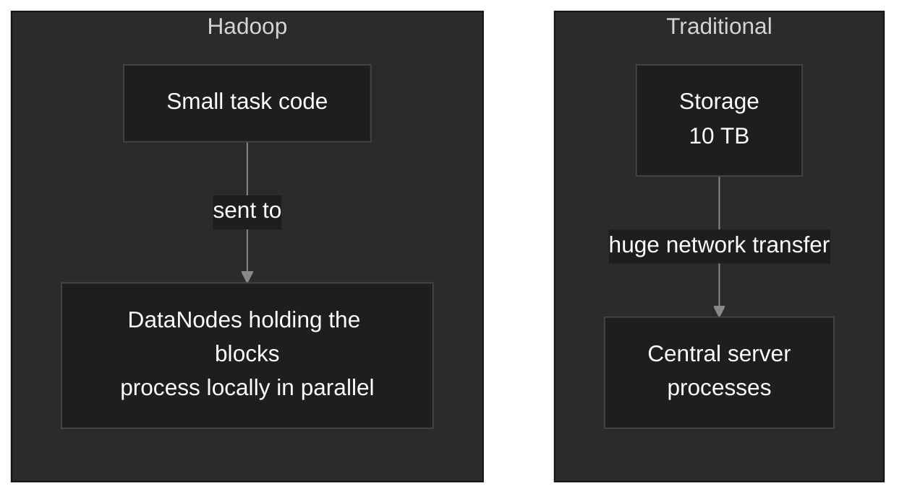
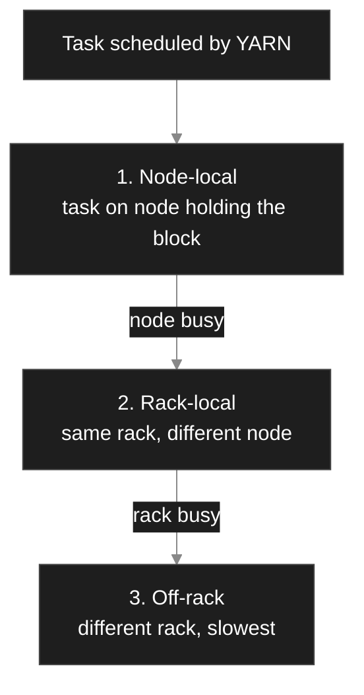
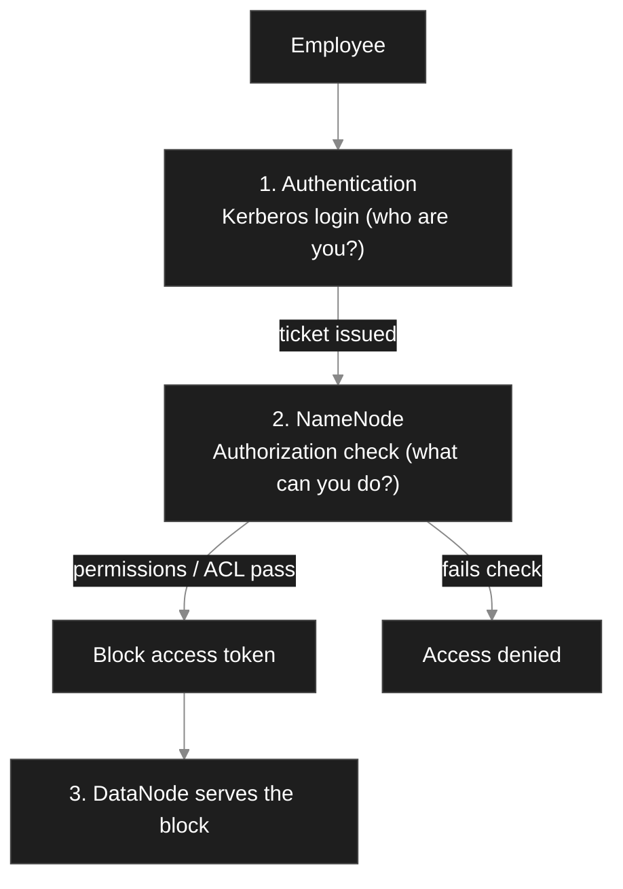

# Big Data on Cloud: Assignment 1

**Scenario-Based Questions: Hadoop & HDFS**

---

## 1. Large E-Commerce Dataset

**Problem:** 5 TB of transaction data arrives every day. A single server runs out of disk space and takes too long to process it.

### How Hadoop and HDFS solve it

- **HDFS (Hadoop Distributed File System)** stores the data across many commodity machines instead of one big server.
- **MapReduce / YARN** processes the data in parallel on those same machines.
- Capacity grows by **adding more nodes** (horizontal scaling), not by buying a bigger server.

### Architecture



### Role of each component

### HDFS Blocks

- Files are split into fixed-size **blocks** (default **128 MB**).
- 5 TB per day is roughly **40,960 blocks** of 128 MB.
- Blocks are spread over many machines, so no single disk has to hold the whole file.
- Large blocks reduce seek time and keep NameNode metadata small.

### DataNodes

- Worker machines that **store the actual blocks** on their local disks.
- Serve read/write requests from clients.
- Send a **heartbeat** (every 3 seconds) and a **block report** to the NameNode.

### Replication

- Each block is copied to **3 DataNodes** by default (replication factor = 3).
- Copies are placed on different nodes and racks.
- If a DataNode fails, the NameNode notices the missing heartbeat and **re-replicates** the lost blocks elsewhere.
- Cost: 5 TB/day becomes about **15 TB/day** of raw storage.

|Problem|Hadoop / HDFS solution|
|---|---|
|Storage limit|Data spread over many nodes; add nodes as needed|
|Slow processing|Parallel processing by MapReduce/YARN on each block|
|Hardware failure|3x replication and automatic re-replication|
|Cost|Runs on cheap commodity hardware|

---

## 2. NameNode Failure

**Problem:** The only NameNode in the cluster becomes unavailable.

### Impact on the cluster

- The **namespace is unreachable**: no one can list, open, create, delete or rename files.
- **Reads and writes stop**, because clients must ask the NameNode where blocks live.
- The data is **not lost**. Blocks are still on the DataNodes, but nobody knows which blocks form which file.
- Running jobs fail and new jobs cannot start.
- The NameNode is a **Single Point of Failure (SPOF)** in a non-HA cluster.

### Why the NameNode is critical

- It holds the **file system metadata**: directory tree, file-to-block mapping, permissions, replication info.
- Metadata is kept in RAM and persisted as **fsimage** (snapshot) plus **edit log** (recent changes).
- It maps each block to the DataNodes holding it (built from block reports).
- It coordinates replication, block placement and DataNode health.



### How High Availability (HA) helps

HA runs **two NameNodes**: one **Active** and one **Standby**.



- **JournalNodes** hold a shared edit log, so the Standby always has up-to-date metadata.
- DataNodes send block reports to **both** NameNodes.
- **ZooKeeper / ZKFC** detects failure and triggers automatic **failover**; the Standby becomes Active within seconds.
- **Fencing** prevents the old Active from writing again (avoids split-brain).
- Note: the **Secondary NameNode** is _not_ a backup. It only merges fsimage and edit logs (checkpointing).

---

## 3. Hospital Data Management

**Verdict:** Yes, HDFS is **largely appropriate**, as long as it is paired with the right tools for small files, structured queries and security.

### Justification

### Scalability

- Data grows every year (images, sensor streams). HDFS scales **horizontally** to petabytes by adding DataNodes.

### Fault tolerance

- Patient data is critical. 3x replication and automatic re-replication protect against disk and node failure.
- NameNode HA removes the single point of failure.

### Distributed storage

- Large files such as MRI/CT images and continuous sensor logs are split into blocks and spread across machines for parallel analysis.

### Data volume and variety

- HDFS stores **any format** (structured, semi-structured, unstructured) without a fixed schema.

|Data type|Fit in HDFS|Note|
|---|---|---|
|Medical images (DICOM)|Good|Large files suit big blocks|
|Sensor / IoT data|Good|Ingest with Kafka or Flume|
|Patient records (structured)|Good|Query using Hive / HBase on top|
|Lab reports (many small files)|Weak|Small-files problem; combine into SequenceFile/HAR/Parquet|

### Limitations to handle

- **Many small files** overload NameNode memory, so merge them.
- **Not for low-latency random access**; use HBase for that.
- **Privacy rules (e.g. HIPAA)** need Kerberos, encryption zones and audit logs.

---

## 4. Data Locality

**Concept described: Data Locality** ("move computation to the data, not data to the computation").

### Traditional approach vs Hadoop



### Levels of locality (best to worst)



### How it improves performance

- **Less network traffic:** only small program code moves, not terabytes of data. Moving 10 TB over a 10 Gbps link would take about 2.3 hours even in ideal conditions.
- **Higher parallelism:** about 81,920 blocks (10 TB / 128 MB) are processed at the same time on many nodes.
- **Reduced bottlenecks:** no central server or single network link is overloaded.
- **Better throughput and scalability:** more nodes means more local processing power.
- **Lower cost:** less bandwidth consumed in the cluster.

---

## 5. HDFS Security Scenario

**Problem:** A bank stores confidential transaction data and different employees need different access levels.

### Security flow



### Authentication (who are you?)

- By default, Hadoop trusts the username given by the client (**simple** mode), which is insecure.
- Production clusters use **Kerberos**: users prove identity with tickets, and services authenticate each other.
- **Delegation tokens** and **block access tokens** let jobs and DataNodes verify access without repeating logins.

### Authorization (what can you do?)

- **POSIX-style permissions:** every file/directory has an owner, a group and others, each with read (r), write (w), execute (x).
- **ACLs (Access Control Lists):** give fine-grained access to specific users or groups beyond owner/group.
- Tools like **Apache Ranger / Sentry** add central, role-based policies.
- Commands: `hdfs dfs -chmod`, `hdfs dfs -chown`, `hdfs dfs -setfacl`.

```bash
hdfs dfs -chown admin:finance /bank/transactions
hdfs dfs -chmod 750 /bank/transactions
hdfs dfs -setfacl -m group:auditors:r-x /bank/transactions
```

### Example access design

|Role|Group|Permission on `/bank/transactions`|
|---|---|---|
|Data Admin|admin|rwx (full control)|
|Finance Analyst|finance|r-x (read and list)|
|Auditor|auditors|r-x (via ACL)|
|Other employees|others|--- (no access)|

### Additional protection

- **Encryption at rest** using HDFS encryption zones and **in transit** using TLS/SASL.
- **Audit logs** record who accessed which file and when.
- **Network isolation** with firewalls around the cluster.

---

### Summary

| Q   | Key idea                                                                  |
| --- | ------------------------------------------------------------------------- |
| 1   | Blocks + DataNodes + replication give scalable, fault-tolerant storage    |
| 2   | NameNode holds metadata; HA with Active/Standby removes the SPOF          |
| 3   | HDFS suits hospital data if small files and security are handled          |
| 4   | Data locality moves code to data, cutting network cost                    |
| 5   | Kerberos (authentication) + permissions/ACLs (authorization) + encryption |