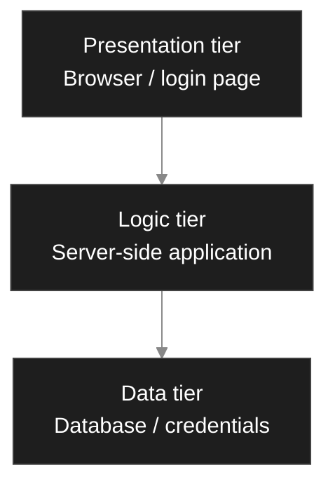
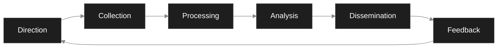

## Assignment 3 — Model Answers
### Unit III & Unit IV: Nimbus / Bluepeak / Sanjeevani Scenarios

---

# Part A — Nimbus Information Systems Pvt. Ltd.

## Case Study
Nimbus Information Systems Pvt. Ltd. authorized an assessment of its corporate network (`10.40.0.0/24`) and customer support portal. OSINT combining WHOIS lookups and targeted Google dork queries uncovered a leaked staff-directory PDF on a public file share. A deeper scan found an old SMB share on a departmental file server using default credentials, providing a foothold and a path to local Administrator. Separately, the support portal's login page built SQL queries directly from unvalidated user input. The visitor Wi-Fi was also found to use WEP.

### **Q1** — Web Server Vulnerabilitiesq
Distinguish a host/web-server-level vulnerability from a web-application-level vulnerability, using the exposed SMB share and the support-portal SQL Injection flaw at Nimbus as your one example of each.

**A1-** A host/web-server-level vulnerability is a weakness in the server software, operating system, or network service running on it, independent of the web application. For example, the SMB share left with default credentials is a host-level issue because it is unrelated to the website's code.

A web-application-level vulnerability is a weakness in the application's own logic. The SQL Injection flaw in the support portal's login page is an example, since it results from unsafe handling of user input within the application. The first requires patching and hardening the server, while the second requires secure coding.

### **Q2** — Web Application Architecture, HTTP/HTTPS
Sketch the layers of a typical three-tier web application (presentation, logic, data) and point out exactly which layer the SQL Injection found on Nimbus's support portal is able to reach.

**A2-** A typical three-tier application consists of:



The SQL Injection originates in the logic tier, where the application builds a database query unsafely. Its impact reaches the data tier because an attacker can manipulate that query to read or alter database content, bypassing the intended boundary between the application and database.

### **Q3** — Wireless Network Cracking Concepts
State, in your own words, why a WEP-secured wireless network is considered crackable by design, and apply this to the risk posed by Nimbus's visitor Wi-Fi.

**A3-** WEP uses RC4 encryption with a short and frequently reused initialization vector (IV). Capturing enough packets with repeated or colliding IVs enables statistical attacks, such as FMS/PTW-style attacks, to recover the key—often within minutes—regardless of the apparent length or complexity of the configured key.

Nimbus's visitor Wi-Fi can therefore be compromised by capturing enough traffic using commonly available tools such as aircrack-ng. This is a protocol-design weakness, not merely a weak-password configuration issue; using a stronger WEP password does not solve it.

### **Q4** — Introduction to Cyber Threat Intelligence (CTI)
Distinguish Cyber Threat Intelligence from the raw OSINT and scan output Nimbus's assessment team gathered, giving one concrete example of each from this engagement.

**A4-** Raw OSINT or scan output is unprocessed data without context about who might exploit it or why. Examples from Nimbus include the leaked staff-directory PDF and Nmap or vulnerability-scan results.

Cyber Threat Intelligence (CTI) turns that data into contextual, actionable knowledge. For example, the directory leak combined with default credentials on an exposed SMB share may indicate an opportunistic attacker targeting legacy file services. Raw data tells the team what was found; CTI explains what it means and what action or detection may be needed.

### **Q5** — TTPs (Tactics, Techniques and Procedures)
Pick one Tactic, Technique and Procedure (TTP) from the Nimbus engagement that is not itself one of the already-logged IoCs, and justify why TTPs typically stay useful for detection longer than IoCs do.

**A5-** One example TTP is gaining initial access through default or weak credentials on an exposed file-sharing service, followed by local privilege escalation. This describes the attacker's method rather than a specific artifact such as an IP address or file hash.

An IoC can be changed easily between attacks—for example, an attacker can use a new IP address or rename a file. A TTP is more persistent because changing it requires changing the attack methodology itself. Therefore, TTP-based detection generally remains useful longer than IoC-based detection.

### **Q6** — XSS Prevention and Secure Coding
Nimbus's product-review field is later found to echo unescaped visitor input straight back into the page. Propose a concrete fix—name the encoding approach and a Content-Security-Policy directive—and explain how it differs mechanically from the parameterized-query fix the SQL Injection needs.

**A6-** The fix is contextual output encoding: HTML-entity encode user-supplied review text before rendering it. This can be implemented using a templating engine's auto-escaping or a library such as OWASP ESAPI. Add a Content-Security-Policy (CSP) header such as:

```http
Content-Security-Policy: default-src 'self'; script-src 'self'
```

This restricts scripts to the same origin and disallows inline scripts and `eval`, reducing the chance of injected scripts executing.

The SQL Injection fix uses parameterized queries or prepared statements to keep user input separate from the SQL command at the database layer. XSS prevention instead ensures that user input is not interpreted as markup or script by the browser. Both prevent untrusted data from becoming executable, but they apply in different contexts: the SQL interpreter versus the browser DOM.

### **Q7** — Introduction to Web Application Security 
Nimbus already runs a signature-based WAF in front of its support portal. Judge whether this WAF alone would plausibly have caught the SQL Injection that was actually found, and give your reasoning.

**A7-** It is unlikely that the WAF would have caught the vulnerability reliably. A signature-based WAF matches known attack patterns, such as common SQL Injection syntax, and may block obvious textbook payloads. However, encoded payloads, second-order injection, or non-standard syntax may not match its signatures and could pass through.

Since the assessment still discovered the flaw, it is reasonable to infer that the vulnerable query pattern was not covered by the WAF's signature set. A WAF can reduce exposure, but it cannot replace a root-cause fix. The application must use parameterized queries regardless of the WAF.

### **Q8** — Real-World CTI Case Studies
Draft the section headings (not the full content) for an internal case-study report covering the Nimbus engagement end to end, from the OSINT recon through to the SQL Injection finding, suitable for Nimbus's own security knowledge base.

**A8-** Suggested report headings:

1. Executive Summary
2. Engagement Scope and Authorization
3. Reconnaissance and OSINT Findings
4. Technical Findings
   - SMB Foothold
   - Privilege Escalation
   - SQL Injection
5. Attack Chain / Kill-Chain Mapping
6. MITRE ATT&CK Technique Mapping
7. Indicators of Compromise (IoCs)
8. Business Impact and Risk Rating
9. Prioritized Remediation Recommendations
10. Appendices — Raw Scan Output, Screenshots, and Timeline

This structure begins with management-level information and then presents technical evidence, impact, recommendations, and supporting material. It can serve both management and the SOC.

### **Q9** — Threat Intelligence Platforms 
Nimbus is building a CTI capability for the first time. Weigh the case for starting with a free/open platform such as MISP against investing directly in a commercial Threat Intelligence Platform.

**A9-** Starting with MISP offers several advantages: no licensing cost, access to a community threat-sharing network, and an opportunity to develop internal processes for tagging, triaging, and acting on intelligence before investing in a more complex platform.

A commercial TIP may be justified if Nimbus has large-scale ingestion requirements or lacks the staff time to host and maintain MISP. Otherwise, the added cost may buy convenience the team is not yet ready to use.

**Conclusion:** Nimbus should begin with MISP to build process maturity at low cost, then reconsider a commercial TIP when intelligence volume and internal maturity justify the investment.

---

# Part B — Bluepeak Financial Services Ltd.

## Case Study
An assessment of Bluepeak Financial Services Ltd.'s internal network (`10.50.0.0/24`) began after an informal email approval, before formal scope sign-off from compliance. A staff member's publicly posted résumé listed exact internal software versions, leading to the discovery of an end-of-life Apache Tomcat instance that was exploited for remote code execution (RCE). The online banking portal's “move funds between accounts” feature accepted state-changing requests without anti-forgery protection (CSRF). The team later mapped the chain to MITRE ATT&CK and delivered a prioritized IoC package to Bluepeak's SOC.

### **Q1** — Cross-Site Scripting (XSS)
Explain how a stored XSS payload differs from a reflected one, and judge which would be the bigger concern if discovered on Bluepeak's “move funds” feature, already known to be CSRF-vulnerable.

**A1-** Reflected XSS requires a victim to click a crafted link. The payload appears in that particular response, making it a one-shot, per-click attack. Stored XSS is saved on the server, such as in a comment or profile field, and is delivered to users who later view that content.

Stored XSS on the “move funds” page would be the greater concern. Combined with the existing CSRF weakness, a script could silently submit a funds-transfer request when a user opens the page, without requiring a click or phishing link.

### **Q2** — Wireless Network Fundamentals
Identify what makes a bank branch's customer-facing Wi-Fi a fundamentally different risk surface from the wired network (`10.50.0.0/24`) that this assessment actually targeted.

**A2-** The wired internal network is generally bounded by physical access controls, such as cabling and building entry, as well as the assessment's defined IP scope. An attacker may need a foothold inside the building or network.

Customer Wi-Fi uses radio signals that can extend beyond the building and be reached by anyone within range, such as someone in a parking lot or nearby premises. It introduces wireless-specific risks, including deauthentication attacks, rogue access points or evil twins, and handshake capture, which the wired assessment did not necessarily cover.

### **Q3** — Intelligence Lifecycle
Walk through the stages of the Intelligence Lifecycle, and place Bluepeak's own MITRE ATT&CK mapping and IoC hand-off into the correct stage(s).

**A3-** The Intelligence Lifecycle proceeds as follows:



- **Direction:** Define intelligence requirements.
- **Collection:** Gather raw data, such as the assessment's technical findings.
- **Processing:** Normalize findings into a usable form.
- **Analysis:** Interpret the data; Bluepeak's MITRE ATT&CK mapping occurs here.
- **Dissemination:** Deliver the IoC package to Bluepeak's SOC.
- **Feedback:** The SOC's response informs the next cycle's direction.

### **Q4** — XSS Prevention and Secure Coding
Suppose Bluepeak's account-statement page is later also found to echo unsanitised input back to the browser. Propose an encoding- and CSP-based remediation, and contrast it with the anti-CSRF-token fix the “move funds” flaw actually needs.

**A4-** The statement page should use context-aware output encoding, such as HTML-encoding user-supplied data before rendering it. A strict CSP, for example `script-src 'self'` without `unsafe-inline`, should also be configured to restrict script execution.

The “move funds” CSRF flaw requires a different control: a per-session or per-request anti-CSRF token embedded in the transfer form and validated server-side when submitted. This helps establish that the request originated from Bluepeak's own page rather than a forged cross-site request.

The weaknesses are mechanically different. XSS allows malicious code to run in the victim's browser, while CSRF tricks the victim's genuine browser into sending an unintended request. Encoding/CSP does not fix CSRF, and a CSRF token does not fix XSS; each requires its own control.

### **Q5** — WEP, WPA and WPA2 Security
Bluepeak's branch guest network runs WPA2 with an eight-character, dictionary-word passphrase. Assess why this still fails to give adequate protection despite WPA2's reputation for strength.

**A5-** WPA2's AES-CCMP encryption protects the wireless traffic, but the passphrase remains the secret on which WPA2-PSK's security depends. An attacker who captures the four-way handshake can perform an offline dictionary attack, testing password candidates without further interaction with the live network. The handshake may be captured passively or, where authorized, by inducing a client to reauthenticate.

An eight-character dictionary word is likely to appear early in common wordlists and can be guessed quickly. Thus, the encryption algorithm's strength is undermined by a guessable key. The main weakness is the poor password choice, not WPA2 itself.

### **Q6** — Threat Profiling and Threat Actors
Build a short threat-actor profile for whoever is behind the Tomcat-RCE-plus-CSRF chain at Bluepeak, covering likely capability, motive, and the TTPs observed.

**A6-**
- **Capability:** Moderate to high. Using a public résumé to identify an end-of-life Tomcat server, exploiting its RCE, and separately locating a CSRF weakness indicates reconnaissance discipline and practical exploit knowledge rather than only automated scanning.
- **Motive:** Most plausibly financial, since the targeted “move funds” feature could enable unauthorized transactions.
- **TTPs observed:** OSINT-based reconnaissance using employee-posted information (comparable to MITRE's Gather Victim Identity Information); exploitation of a public-facing application vulnerability (Exploit Public-Facing Application); and abuse of a web-application logic flaw (CSRF) to perform unauthorized transactions rather than relying on traditional credential theft.

### **Q7** — Types and Importance of Threat Intelligence
Weigh the sector-wide benefit against the regulatory and confidentiality risk of Bluepeak sharing this incident's IoCs and TTPs with a banking-sector ISAC.

**A7-** Sharing can improve the entire banking sector's defenses against a potentially reused attacker playbook. Reciprocal sharing may also reveal indicators that other banks have already observed, improving detection speed.

However, financial incidents may involve regulatory disclosure requirements and customer-confidentiality constraints. Sharing raw technical details may also expose Bluepeak's remediation gaps before they are closed.

**Balanced conclusion:** Bluepeak should promptly share sanitized, TTP-level intelligence that provides sector value while minimizing confidentiality risks. Identifying details should be withheld until remediation and any required regulatory disclosures are complete.

---

# Part C — Sanjeevani Care Hospitals Pvt. Ltd.

## Case Study
Sanjeevani Care Hospitals Pvt. Ltd. authorized an assessment of its internal network (`10.60.0.0/24`) and patient-facing booking application on verbal approval, while the formal data-protection agreement was still under legal review. Names and job titles from LinkedIn and a leaked medical-conference attendee list supported a pretexting attempt. An unpatched SMBv1 service provided a foothold and a path to Domain Admin. The appointment-booking page stored an unsanitized script that executed when staff later opened the record (stored XSS). The team subsequently mapped the findings to MITRE ATT&CK and handed over a prioritized IoC package.

### **Q1** — SQL Injection Concepts
Sanjeevani's appointment-search feature also builds its database queries directly from the search box. Explain why unsanitised input here would expose it to SQL Injection, and why this matters more in a healthcare setting than elsewhere.

**A1-** If the search box concatenates user input directly into a SQL query instead of using parameterized queries, an attacker can inject SQL syntax—for example, `' OR '1'='1`—that changes the query's logic. This may return unauthorized records, bypass filters, or cause further database compromise.

The risk is greater in healthcare because the exposed information may include patient names, appointment reasons, and linked medical records. Such health information is highly sensitive, so disclosure can have serious regulatory consequences and damage patient trust.

### **Q2** — Web Server Vulnerabilities
Separate host-level vulnerabilities from application-level vulnerabilities, using the unpatched SMBv1 service and the booking application as Sanjeevani's own two examples.

**A2-**
- **Host-level vulnerability:** The unpatched SMBv1 service. This is a weakness in the operating system or network-service software and can be exploited independently of the hospital's web application.
- **Application-level vulnerability:** The stored-XSS flaw in the booking application. It results from how the application handles and renders user input, rather than from the underlying OS or server version.

### **Q3** — Indicators of Compromise (IoCs)
Contrast an Indicator of Compromise with a Tactic, Technique and Procedure, drawing your two examples from the SMBv1 compromise and the stored-XSS finding at Sanjeevani.

**A3-** An IoC is a specific, observable artifact associated with a compromise. Examples include the exact SMBv1 exploit's network signature or the specific script string stored in the booking record.

A TTP describes the broader behavior or method behind the attack. Examples are “exploits unpatched legacy file-sharing services for initial foothold” (SMBv1) and “abuses unsanitized web-form input for persistent script execution” (stored XSS). IoCs are concrete and can be changed by an attacker; TTPs describe the method and often persist across campaigns.

### **Q4** — Mapping Threats using MITRE ATT&CK
Apply MITRE ATT&CK to place each stage of Sanjeevani's attack chain—LinkedIn/conference-list recon, SMBv1 foothold, Domain Admin escalation, stored XSS—under its correct tactic.

**A4-**

| Attack stage | MITRE ATT&CK tactic |
|---|---|
| LinkedIn / conference-list reconnaissance | Reconnaissance — gathering victim identity information to support pretexting |
| SMBv1 foothold | Initial Access / Execution — exploiting a remote or legacy network service to gain entry |
| Domain Admin escalation | Privilege Escalation — moving from a low-privilege foothold to a high-value administrative account |
| Stored XSS on booking page | Persistence / Execution — the payload remains stored and is triggered when staff use the application |

### **Q5** — Wireless Network Cracking Concepts
Apply your understanding of wireless cracking to lay out, step by step, how you would test Sanjeevani's WPA2-PSK clinic network for a weak passphrase, bearing in mind the sensitivity of the data it ultimately protects.

**A5-** The test should be performed only within the authorized scope:

1. Identify the target access point's SSID and BSSID, and place the wireless adapter into monitor mode.
2. Passively capture traffic associated with the BSSID and wait for a WPA2 four-way handshake. With explicit authorization, a targeted deauthentication may be used to prompt a client to reauthenticate.
3. After capturing the handshake, run an offline dictionary or rule-based password test using a tool such as aircrack-ng or hashcat. A context-aware wordlist may be included in the assessment.
4. If a weak passphrase is recovered, document the result and stop at proof-of-concept. Because the clinical network may protect sensitive patient systems, do not pivot further than necessary to demonstrate the weakness; report it promptly.

### **Q6** — Threat Intelligence Platforms
Weigh a free/open platform such as MISP against a commercial Threat Intelligence Platform for Sanjeevani, given its data-protection obligations as a healthcare provider.

**A6-** MISP is self-hosted, allowing Sanjeevani to maintain control over where patient-adjacent threat data is stored and who can access it. This is valuable when data-protection obligations require demonstrable custody and access control.

A commercial TIP may provide stronger out-of-the-box enrichment and vendor support, but it introduces a third-party data-processor relationship that requires a data-protection agreement and due diligence, increasing compliance overhead.

**Trade-off:** MISP better supports the default preference to minimize third-party data exposure, provided the hospital has the capacity to maintain it. A commercial TIP may be justified later if a properly vetted and compliant vendor is available.

### **Q7** — SQL Injection Prevention
Judge the business and regulatory exposure of a hypothetical SQL Injection flaw on Sanjeevani's appointment-search field against the stored-XSS flaw that was actually found, considering health-data protection requirements.

**A7-** The confirmed stored-XSS flaw exposes staff who open an infected record to script execution. It is primarily an integrity and availability risk to the internal application and may act as a stepping-stone to further compromise, but it does not by itself directly dump patient records.

A hypothetical SQL Injection flaw in the appointment-search field could directly expose or exfiltrate large amounts of patient health data through a single query. This would be a direct confidentiality breach involving regulated health information, with potentially greater breach-notification and penalty implications.

**Conclusion:** The hypothetical SQL Injection represents the greater business and regulatory risk, even though stored XSS is the vulnerability confirmed during the assessment.